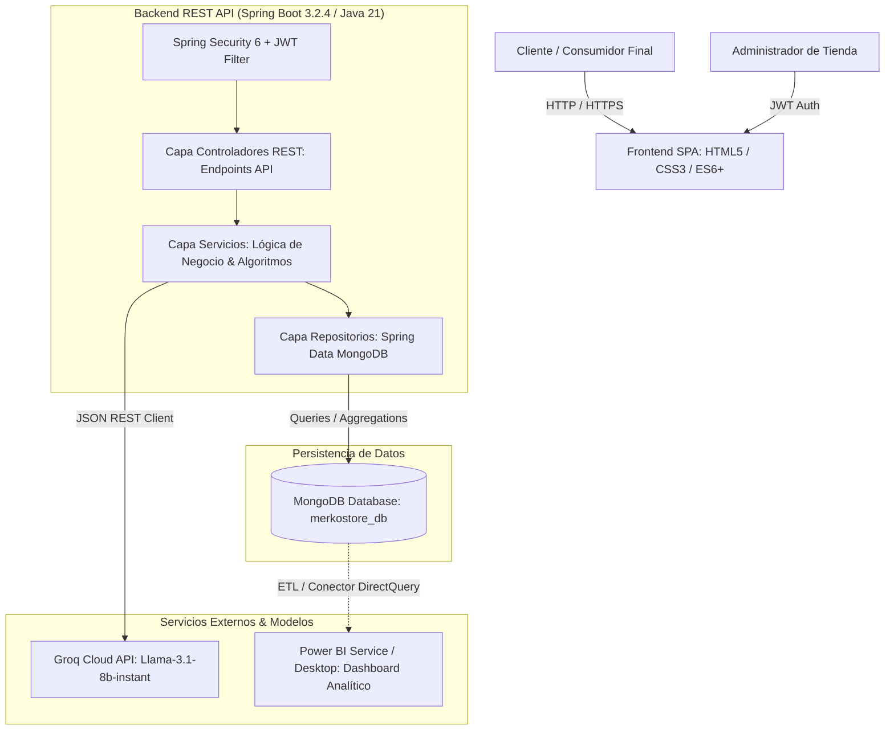

# 🛒 Merkostore - Plataforma Web E-Commerce & Gestión Integral para Tiendas de Barrio

[](https://spring.io/projects/spring-boot)
[](https://www.oracle.com/java/)
[](https://www.mongodb.com/)
[]()
[]()

> **Proyecto de Aula Interdisciplinario - VII Semestre de Ingeniería de Sistemas**  
> **Asignaturas Articuladas:**  
> 1. Desarrollo Web Avanzado  
> 2. Visualización de Datos II  
> 3. Investigación de Operaciones  

---

## 📌 Descripción del Proyecto

**Merkostore** es una solución tecnológica web integral diseñada para digitalizar, optimizar y potenciar las operaciones de comercio minorista y tiendas de barrio en Colombia. La plataforma articula:

1. **Catálogo Digital y Tienda Online Responsiva**: Experiencia de compra fluida orientada al consumidor final, permitiendo compras al detal y adquisición de "Mercados Combos" familiares con despacho a domicilio o retiro en tienda y confirmación inmediata vía WhatsApp Business.
2. **Asistente Inteligente (MerkoBot IA)**: Integración con Modelos de Lenguaje Masivos (LLM - Llama 3.1 8B vía Groq Cloud) que asesora al cliente en tiempo real recomendando productos según su presupuesto y verificando existencias directamente en la base de datos.
3. **Panel Administrativo Ejecutivo (ERP / Backoffice)**: Tablero de métricas en tiempo real (KPIs de ventas, pedidos activos, margen bruto), control de inventario con inactivación controlada de productos (sin borrado destructivo), gestión de categorías y seguimiento de pedidos por fases.
4. **Módulo de Analítica y BI (Visualización de Datos)**: Integración con dashboards de Power BI basados en un modelo dimensional estrella (Fact_Ventas y dimensiones asociadas).
5. **Motor de Optimización Matemática (Investigación de Operaciones)**: Modelo de programación lineal entera que optimiza la composición y asignación de inventario entre la venta al detal y combos armados maximizando el margen de ganancia diario.

---

## 🏗️ Arquitectura del Sistema

La solución adopta una **Arquitectura en Capas (Layered Architecture)** siguiendo el patrón arquitectónico estándar de la industria empresarial en Spring Boot:



### Responsabilidad de Capas:
- **Presentation Layer (Frontend)**: SPA sin dependencias pesadas construida en Vanilla JavaScript ES6+, HTML5 semántico y CSS3 con diseño responsivo mobile-first.
- **Security Layer**: Filtro `JwtAuthenticationFilter` stateless que intercepta cabeceras `Authorization: Bearer <token>`, validando claims, expiración y roles (`ROLE_ADMIN`).
- **Controller Layer (`com.merkostore.api.controllers`)**: Exposición de endpoints RESTful con validación declarativa (`@Valid`), negociación de contenido JSON y manejo uniforme de respuestas con `ApiResponse<T>`.
- **Service Layer (`com.merkostore.api.services`)**: Orquestación de reglas de negocio, control de concurrencia e idempotencia en pedidos (`OrderService`) y gestión del agente conversacional (`ChatbotService`).
- **Data Access Layer (`com.merkostore.api.repositories`)**: Interfaces Spring Data sobre MongoDB para consultas automáticas, agregaciones complejas y persistencia documental.

---

## 🛠️ Stack Tecnológico

| Componente | Tecnología | Versión / Detalle |
| :--- | :--- | :--- |
| **Lenguaje Backend** | Java | OpenJDK 21 LTS |
| **Framework Backend** | Spring Boot | 3.2.4 |
| **Seguridad & Auth** | Spring Security + JJWT | 6.2.3 / jjwt 0.12.5 (HMAC-SHA256) |
| **Persistencia NoSQL** | MongoDB | 7.0 Community / Atlas |
| **ORM / ODM** | Spring Data MongoDB | 4.2.4 |
| **Inteligencia Artificial** | Groq Cloud API | Modelo Llama 3.1 8B Instant |
| **Frontend** | HTML5, CSS3, JavaScript | ES6+ Moderno (Vanilla SPA) |
| **Analítica & BI** | Microsoft Power BI | Desktop & Service (Modelo Dimensional) |
| **Investigación de Operaciones** | Python / PuLP / Simplex | 3.12 (Programación Lineal Entera) |
| **Gestor de Dependencias** | Apache Maven | 3.9+ |

---

## 📂 Estructura del Código Fuente

```text
merkostore/
├── docs/                                  # Documentación técnica y entregables del Proyecto de Aula
│   ├── 1_DOCUMENTO_TECNICO_DESARROLLO_WEB.md
│   ├── 2_EVIDENCIAS_VISUALIZACION_DATOS_POWERBI.md
│   ├── 3_INVESTIGACION_DE_OPERACIONES_MODELO.md
│   ├── 4_INFORME_METODOLOGICO_FINAL_APA7.md
│   ├── 5_MATRIZ_INTEGRACION_INTERDISCIPLINARIA.md
│   └── optimizacion_combos_merkostore.py   # Script funcional de PLE en Python
├── src/
│   ├── main/
│   │   ├── java/com/merkostore/api/
│   │   │   ├── config/                    # Seguridad, inicialización y CORS
│   │   │   │   ├── DataInitializer.java
│   │   │   │   └── SecurityConfig.java
│   │   │   ├── controllers/               # Controladores REST API
│   │   │   │   ├── AdminDashboardController.java
│   │   │   │   ├── AuthController.java
│   │   │   │   ├── ChatbotController.java
│   │   │   │   ├── OrderController.java
│   │   │   │   └── PublicCatalogController.java
│   │   │   ├── dtos/                      # Objetos de Transferencia de Datos
│   │   │   │   ├── ApiResponse.java
│   │   │   │   ├── AuthResponse.java
│   │   │   │   ├── ChatRequest.java / ChatResponse.java
│   │   │   │   ├── CreateOrderRequest.java
│   │   │   │   └── LoginRequest.java
│   │   │   ├── exceptions/                # Manejadores globales de errores
│   │   │   ├── models/                    # Entidades / Documentos de MongoDB
│   │   │   │   ├── Category.java
│   │   │   │   ├── ChatMessage.java
│   │   │   │   ├── FinancialTransaction.java
│   │   │   │   ├── Order.java
│   │   │   │   ├── Product.java
│   │   │   │   ├── StoreConfig.java
│   │   │   │   └── User.java
│   │   │   ├── repositories/              # Repositorios Spring Data MongoDB
│   │   │   ├── security/                  # Proveedor y filtros de JWT
│   │   │   │   ├── CustomUserDetailsService.java
│   │   │   │   ├── JwtAuthenticationFilter.java
│   │   │   │   └── JwtTokenProvider.java
│   │   │   ├── services/                  # Lógica de negocio
│   │   │   │   ├── ChatbotService.java
│   │   │   │   └── OrderService.java
│   │   │   └── MerkostoreApplication.java # Clase principal Spring Boot
│   │   └── resources/
│   │       ├── application.properties     # Configuración de la aplicación
│   │       └── static/                    # Cliente Web Frontend (HTML, CSS, JS)
│   └── test/                              # Pruebas unitarias y de integración
├── pom.xml                                # Dependencias y build de Maven
└── README.md                              # Guía del repositorio
```

---

## 🚀 Requisitos e Instalación

### Prerrequisitos:
1. **Java JDK 21 LTS** instalado y configurado en `JAVA_HOME`.
2. **Apache Maven 3.8+** (o usar el wrapper incluido).
3. **MongoDB Server 6.0 o 7.0** corriendo localmente en el puerto `27017` (o URI de MongoDB Atlas).
4. **Navegador web moderno** (Google Chrome, Mozilla Firefox, Microsoft Edge).

---

## ⚙️ Configuración del Entorno (Variables de Entorno)

La aplicación utiliza variables parametrizadas en `src/main/resources/application.properties` para garantizar que **no se expongan credenciales ni claves privadas en el repositorio**:

| Variable | Descripción | Valor por Defecto / Ejemplo |
| :--- | :--- | :--- |
| `server.port` | Puerto HTTP del servidor Spring Boot | `8085` |
| `spring.data.mongodb.uri` | Cadena de conexión a MongoDB | `mongodb://localhost:27017/merkostore_db` |
| `GROQ_API_KEY` | Clave de API de Groq Cloud para IA | *(Opcional)* Si no se define, opera con respuestas heurísticas |
| `merkostore.jwt.secret` | Clave secreta para firma HMAC de tokens | Clave de 256 bits preconfigurada |

### Plantilla de archivo `.env` o variables locales:
```bash
# Variables de entorno opcionales para producción
export SERVER_PORT=8085
export MONGODB_URI=mongodb://localhost:27017/merkostore_db
export GROQ_API_KEY=gsk_tu_clave_de_groq_aqui
```

---

## 📦 Compilación y Ejecución

### 1. Clonar el repositorio
```bash
git clone https://github.com/tu-usuario/merkostore.git
cd merkostore
```

### 2. Compilar con Maven
```bash
mvn clean compile
```

### 3. Ejecutar pruebas unitarias
```bash
mvn test
```

### 4. Iniciar la aplicación
```bash
mvn spring-boot:run
```

La aplicación arrancará y estará disponible en:
```text
http://localhost:8085/
```

---

## 🔐 Credenciales del Sistema

Al iniciar por primera vez, el componente `DataInitializer` inicializa automáticamente la base de datos con categorías, productos demo y el usuario administrador:

- **URL de Acceso**: `http://localhost:8085/`
- **Usuario Administrador**: `admin`
- **Contraseña**: `1212`
- **Rol**: `ROLE_ADMIN`

*(Para acceder al panel administrativo, hacer clic en el botón con icono de candado "Admin" en la esquina superior derecha del menú).*

---

## 📡 Principales Endpoints de la API REST

### Catálogo Público
- `GET /api/v1/public/categories` - Listado de categorías activas ordenadas.
- `GET /api/v1/public/products` - Catálogo de productos disponibles para compra.
- `POST /api/v1/public/chat` - Consulta al agente inteligente MerkoBot IA (LLM).

### Pedidos & Checkout
- `POST /api/v1/orders` - Creación transaccional de un nuevo pedido con verificación de stock e idempotencia.
- `GET /api/v1/orders/{orderNumber}` - Consulta de estado y detalle de pedido por código (`MS-XXXX`).

### Autenticación
- `POST /api/v1/auth/login` - Autenticación con credenciales y emisión de token JWT.

### Panel Administrativo (Requiere `Bearer <JWT>`)
- `GET /api/v1/admin/dashboard/metrics` - Resumen ejecutivo de ventas, pedidos y transacciones.
- `GET /api/v1/admin/products` - Listado total de productos (incluyendo inactivos).
- `POST /api/v1/admin/products` - Creación de nuevo producto o mercado combo.
- `PATCH /api/v1/admin/products/{id}/toggle-availability` - Inactivación/activación de producto en catálogo.
- `DELETE /api/v1/admin/categories/{id}` - Eliminación definitiva de categoría.
- `GET /api/v1/admin/orders` - Historial unificado de pedidos.
- `DELETE /api/v1/admin/orders/{id}` - Eliminación definitiva de registro del historial.
- `PUT /api/v1/admin/store-config` - Parámetros de la tienda (teléfono WhatsApp, monto mínimo, tarifas de envío).

---

## 👥 Equipo de Trabajo & Integrantes

- **Estudiante(s)**: Integrantes del Equipo de Proyecto de Aula
- **Programa**: Ingeniería de Sistemas - VII Semestre
- **Institución**: Corporación Universitaria Rafael Núñez / Plataforma FERRUM
- **Año Lectivo**: 2026
