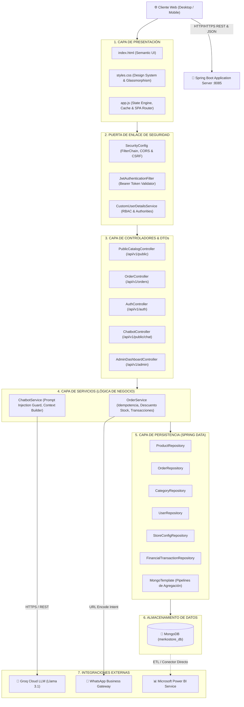
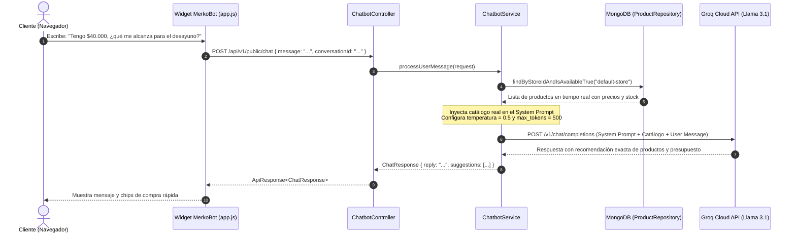
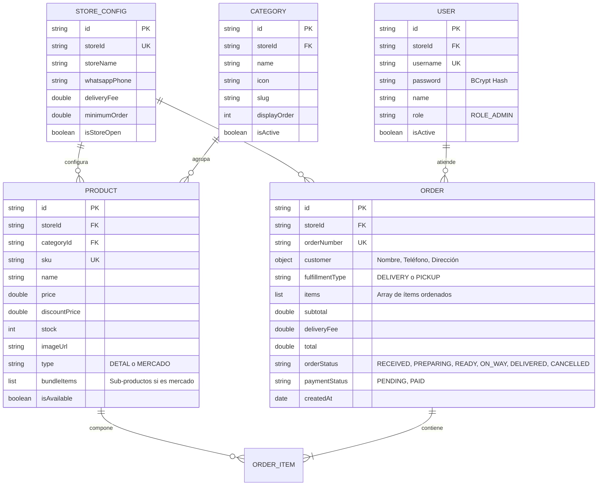

# 📘 DOCUMENTO TÉCNICO DE ARQUITECTURA Y DESARROLLO SOFTWARE
## PROYECTO: MERKOSTORE - SISTEMA DE COMERCIO MINORISTA INTELIGENTE
### ASIGNATURA: DESARROLLO WEB AVANZADO
**Programa:** Ingeniería de Sistemas - VII Semestre  
**Institución:** Corporación Universitaria Rafael Núñez / Plataforma FERRUM  
**Año Lectivo:** 2026  

---

## 1. STACK Y AMBIENTE TECNOLÓGICO

El ecosistema tecnológico de **Merkostore** fue seleccionado estratégicamente para garantizar alta concurrencia, escalabilidad horizontal, seguridad perimetral y una experiencia de usuario ultra-rápida y responsiva:

### 1.1. Lenguajes de Programación
- **Backend**: **Java 21 (LTS)**. Aprovecha las características modernas del lenguaje (Records, Pattern Matching, optimizaciones de memoria y compatibilidad con hilos virtuales de Project Loom).
- **Frontend**: **JavaScript ECMAScript 6+ (ES2023)**. Programación asíncrona moderna (`async/await`, Fetch API, Web Storage API y manipulación reactiva del DOM).

### 1.2. Frameworks y Bibliotecas Backend
- **Spring Boot 3.2.4**: Framework principal para el desarrollo de microservicios y APIs REST empresariales.
- **Spring Security 6.2.3**: Módulo de seguridad perimetral, gestión de políticas de autorización y autenticación sin estado (Stateless).
- **JJWT (io.jsonwebtoken 0.12.5)**: Implementación de JSON Web Tokens utilizando firmas criptográficas seguras HMAC-SHA256 (`HS256`).
- **Spring Data MongoDB 4.2.4**: Abstracción de acceso a datos para bases documentales NoSQL con soporte de `MongoTemplate` para agregaciones analíticas.
- **Jakarta Validation API 3.0.2 & Hibernate Validator**: Validación declarativa de esquemas y payloads de entrada en endpoints.
- **Spring Boot Actuator**: Telemetría, monitoreo de salud del sistema (`/actuator/health`) y métricas de rendimiento en tiempo real.

### 1.3. Sistema Gestor de Bases de Datos
- **MongoDB Community Server 7.0 / MongoDB Atlas**: Motor de base de datos NoSQL orientado a documentos JSON/BSON. Permite esquemas dinámicos ideales para productos con atributos variantes (e.g. productos por peso vs. unidades fijas vs. combos armados) y alta velocidad de escritura en transacciones de pedidos concurrentes.

### 1.4. Herramientas de Desarrollo y Build
- **Apache Maven 3.9+**: Automatización del ciclo de vida del software, compilación, ejecución de pruebas unitarias y gestión declarativa del árbol de dependencias (`pom.xml`).
- **Lombok**: Reducción de código repetitivo (Boilerplate) para DTOs y modelos de datos (`@Data`, `@Builder`, `@NoArgsConstructor`, `@AllArgsConstructor`).

### 1.5. Servicios Externos y Tecnologías de Inteligencia Artificial
- **Groq Cloud API (LPU Inference Engine)**: Proveedor de inferencia de ultrabaja latencia para Modelos de Lenguaje Masivos (LLM).
- **Llama 3.1 8B Instant (`llama-3.1-8b-instant`)**: Modelo de lenguaje abierto de Meta AI, ajustado para comprensión contextual de catálogos y asistencia conversacional en tiempo real a clientes.
- **WhatsApp Business API Link Generator**: Protocolo de comunicación universal (`https://wa.me/`) para confirmación instantánea de órdenes de compra directamente al dispositivo móvil del despachador y del cliente.

---

## 2. ARQUITECTURA DE LA APLICACIÓN

### 2.1. Diagrama de Arquitectura General



### 2.2. Descripción de la Arquitectura por Capas

1. **Capa de Presentación (Frontend SPA)**:  
   Implementada como una Single Page Application (SPA) ligera, sin la sobrecarga ni incompatibilidades de librerías externas. Posee un motor de estado reactivo global (`state`), un subsistema de caché en `localStorage` (`Storage`) que asegura la persistencia de configuraciones e inactivaciones incluso si el usuario recarga o pierde temporalmente conexión, y animaciones aceleradas por hardware en CSS.

2. **Capa de Seguridad (Security Filter Chain)**:  
   Basada en `SecurityFilterChain` de Spring Security 6. Utiliza un esquema de autenticación sin estado (Stateless Session Management) donde cada petición protegida es interceptada por `JwtAuthenticationFilter`. Valida la integridad criptográfica de la firma del token mediante la clave secreta `merkostore.jwt.secret`, extrayendo el nombre de usuario y el rol (`ROLE_ADMIN`). Los endpoints de catálogo público, chat y registro de pedidos son abiertos (`permitAll`), mientras que todas las rutas bajo `/api/v1/admin/**` requieren el claim de autorización correspondiente.

3. **Capa de Controladores (REST Controllers)**:  
   Expone la interfaz de comunicación HTTP RESTful. No contiene lógica de negocio pesada; su función es recibir los payloads JSON, validarlos contra anotaciones de Bean Validation (`@Valid`, `@NotNull`, `@NotBlank`, `@Min`), coordinar con los servicios y retornar respuestas consistentes encapsuladas en la clase estándar `ApiResponse<T>`, garantizando trazabilidad y códigos de estado HTTP precisos (200 OK, 201 Created, 400 Bad Request, 401 Unauthorized, 404 Not Found).

4. **Capa de Servicios (Service Layer)**:  
   Núcleo donde residen las reglas de negocio, algoritmos y orquestación. Destacan:
   - `OrderService`: Implementa un mecanismo de **idempotencia** mediante el token `idempotencyKey` para evitar pedidos duplicados ante reintentos del usuario; calcula de forma determinista subtotales, tarifas de envío dinámicas según el monto mínimo configurado en la tienda y realiza la actualización atómica del inventario de productos.
   - `ChatbotService`: Construye dinámicamente un prompt del sistema que inyecta los productos y precios reales de la tienda en el contexto del LLM, protegiendo contra inyecciones de prompt maliciosas y retornando sugerencias accionables estructuradas.

5. **Capa de Acceso a Datos (Repository Layer)**:  
   Interfaces que extienden `MongoRepository<T, ID>`, aprovechando la generación dinámica de consultas de Spring Data MongoDB (e.g. `findByStoreIdAndIsAvailableTrue`, `existsByUsername`). Además, `AdminDashboardController` y `OrderService` emplean directamente `MongoTemplate` para construir pipelines de agregación analítica (`Aggregation.match`, `Aggregation.group().sum()`) para el cálculo instantáneo de métricas financieras.

---

## 3. ESTRUCTURA E IMPLEMENTACIÓN DEL PROYECTO

### 3.1. Organización de Paquetes
```text
com.merkostore.api
├── config/              # Clases @Configuration (Seguridad, inicializadores de BD)
├── controllers/         # Endpoints REST (Controladores HTTP)
├── dtos/                # Data Transfer Objects para requests y responses JSON
├── exceptions/          # Excepciones de negocio y GlobalExceptionHandler (@RestControllerAdvice)
├── models/              # Documentos @Document mapeados en colecciones MongoDB
├── repositories/        # Interfaces Spring Data MongoDB
├── security/            # Componentes JWT y UserDetailsService
└── services/            # Lógica de negocio transaccional y servicios externos
```

### 3.2. Catálogo de Endpoints REST Principales

| Método | Endpoint | Acceso | Descripción |
| :--- | :--- | :--- | :--- |
| `GET` | `/api/v1/public/categories` | Público | Lista de categorías de productos activas |
| `GET` | `/api/v1/public/products` | Público | Catálogo de productos disponibles con stock > 0 |
| `POST` | `/api/v1/public/chat` | Público | Consulta al Asistente Inteligente MerkoBot IA |
| `POST` | `/api/v1/orders` | Público | Creación de pedido y actualización de stock |
| `GET` | `/api/v1/orders/{orderNumber}` | Público | Consulta de estado de pedido para el cliente |
| `POST` | `/api/v1/auth/login` | Público | Autenticación de administradores (retorna JWT) |
| `GET` | `/api/v1/admin/dashboard/metrics`| `ROLE_ADMIN` | KPIs: Ventas, pedidos activos, historial reciente |
| `GET` | `/api/v1/admin/products` | `ROLE_ADMIN` | Inventario completo (incluye inactivos) |
| `POST` | `/api/v1/admin/products` | `ROLE_ADMIN` | Registro de nuevo producto o mercado combo |
| `PATCH`| `/api/v1/admin/products/{id}/toggle-availability` | `ROLE_ADMIN` | Inactivar/Activar producto en catálogo |
| `DELETE`| `/api/v1/admin/categories/{id}` | `ROLE_ADMIN` | Eliminación definitiva de categoría |
| `DELETE`| `/api/v1/admin/orders/{id}` | `ROLE_ADMIN` | Eliminación definitiva de pedido del historial |
| `PUT` | `/api/v1/admin/store-config` | `ROLE_ADMIN` | Configuración de tienda (teléfono, domicilio) |

---

## 4. INTERFAZ DE USUARIO

La interfaz de Merkostore fue diseñada bajo los principios de **diseño limpio (Clean Design)**, eliminando ruido visual y elementos distractores:

1. **Top Bar Informativa**:
   - Muestra el canal directo de soporte y el costo de entrega configurado en la tienda.
2. **Navegación y Categorías Dinámicas**:
   - Carrusel de badges interactivos filtrables con emojis temáticos (`Lácteos y Huevos`, `Granos`, `Bebidas`, `Aseo`, etc.).
3. **Tarjetas de Producto Optimizadas**:
   - Imagen nítida en proporción fija, tipografía jerárquica con precio destacado en COP, control de cantidad (+/-) integrado y etiqueta de "Agotado" cuando el stock es cero.
4. **Carrito de Compras Flotante & Checkout Drawer**:
   - Barra de progreso que valida si el cliente alcanza el **Monto Mínimo de Pedido**.
   - Selector entre "Envío a Domicilio" (suma automáticamente la tarifa de despacho) y "Recogida en Tienda" ($0 de envío).
   - Generación de enlace universal a WhatsApp que pre-llena el mensaje con el resumen detallado del pedido y el código único de seguimiento (`MS-XXXX`).
5. **Panel Administrativo Ejecutivo (Backoffice)**:
   - **Dashboard**: Métricas clave en tarjetas KPI, pedidos activos en vivo y gráfico de barras de ventas semanales.
   - **Gestión de Inventario**: Tabla con interruptores directos de stock (`✓ En Stock` / `✕ Agotado`) e inactivación lógica (`🚫 Inactivar` / `✅ Activar`) que no destruye los registros históricos.
   - **Editor de Mercados Combos**: Herramienta para componer paquetes familiares seleccionando insumos base con cálculo automático de stock disponible.
   - **Historial Unificado**: Filtros por estado, fecha y tipo de pedido con opción de inspección de detalle y botón de eliminación definitiva (`🗑️ Eliminar`).

---

## 5. INTEGRACIÓN CON MODELOS DE LENGUAJE (LLM) - MERKOBOT IA

### 5.1. Proveedor y Modelo
- **Proveedor:** Groq Cloud Platform.
- **Modelo:** `llama-3.1-8b-instant`.
- **Mecanismo:** Cliente HTTP `RestTemplate` con inyección segura de cabeceras (`Authorization: Bearer ${GROQ_API_KEY}`) y serialización JSON.

### 5.2. Arquitectura de Inferencia y Prompt Engineering
El servicio `ChatbotService` implementa una arquitectura de **Recuperación Aumentada en Contexto (In-Context RAG)**:



---

## 6. MODELO DE DATOS (PERSISTENCIA NoSQL)

El esquema documental de MongoDB está diseñado para maximizar la velocidad de lectura del catálogo y mantener la consistencia en los pedidos:



---
*Fin del Documento Técnico.*
