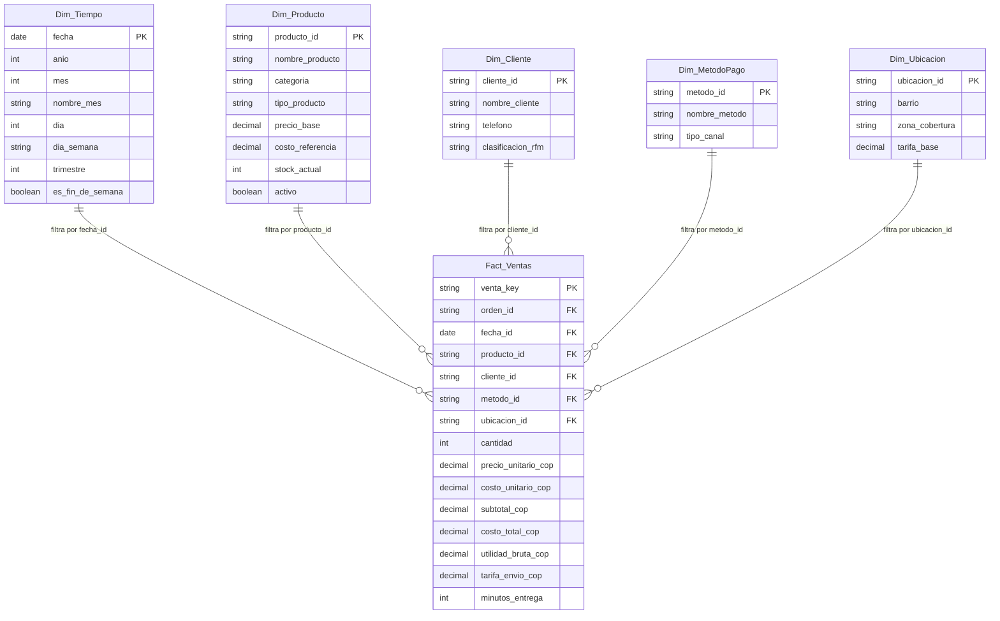

# Evidencias del Dashboard Interactivo en Power BI
## Asignatura: Visualización de Datos II
### Proyecto: MERKOSTORE - Plataforma E-Commerce Barrial Inteligente
**Carrera:** Ingeniería de Sistemas — VII Semestre  
**Fecha de Entrega:** Noviembre de 2026  

---

## 1. Introducción y Contextualización del Negocio

El proyecto **Merkostore** aborda la transformación digital del comercio barrial tradicional mediante una plataforma web híbrida (Spring Boot 3 + MongoDB + Groq LLM) respaldada por un sistema integral de **Inteligencia de Negocios (BI)** y Analítica Visual desarrollado en **Microsoft Power BI**.

El objetivo de este componente es dotar a los tenderos y administradores de paneles de control visuales interactivos que transformen los datos transaccionales crudos (pedidos, clientes, combos de mercado y movimientos financieros) en **insights accionables** que optimicen la rotación de inventarios, la rentabilidad por categoría y los tiempos de despacho domiciliario.

---

## 2. Fuentes de Datos y Estrategia de Extracción

### 2.1. Orígenes de Información Operacional
Los datos analíticos provienen directamente de la base de datos NoSQL **MongoDB Atlas / Local**, estructurada en las siguientes colecciones operativas:

| Colección Origen | Granularidad | Registros / Volumen | Descripción de Atributos Clave |
| :--- | :--- | :--- | :--- |
| `orders` | Nivel cabecera de pedido | Histórico diario continuo | `id`, `storeId`, `orderNumber`, `customerName`, `customerPhone`, `address`, `neighborhood`, `paymentMethod`, `paymentStatus`, `orderStatus`, `subtotal`, `deliveryFee`, `total`, `createdAt` |
| `orders.items` (array anidado) | Nivel línea de detalle de pedido | 1:N respecto a cabecera | `productId`, `productName`, `quantity`, `unitPrice`, `subtotal`, `type` (`DETAL` o `MERCADO`) |
| `products` | Nivel catálogo maestro | Maestro de SKU y combos | `id`, `name`, `categoryId`, `costPrice`, `price`, `discountPrice`, `stock`, `unit`, `type`, `isAvailable` |
| `financial_transactions` | Nivel asiento de caja | Libro diario de caja | `id`, `orderId`, `type` (`INCOME`/`EXPENSE`), `amount`, `category`, `paymentMethod`, `date` |
| `categories` | Maestro taxonómico | 6 categorías activas | `id`, `name`, `slug`, `displayOrder`, `isActive` |

### 2.2. Proceso de Integración y Transformación (ETL con Power Query / M)
Para conectar Power BI a MongoDB se empleó el conector **MongoDB BI Connector** vía ODBC y la exportación estructurada mediante scripts automatizados en formato JSON/Parquet hacia el staging area.

#### Pipeline ETL en Power Query:
1. **Extracción (Extract):** Ingesta de las colecciones en documentos JSON normalizados.
2. **Desanidado (Flattening):** Desagregación del arreglo `items[]` mediante `Table.ExpandRecordColumn` para aislar la granularidad de línea de producto sin perder los atributos de cabecera de la orden.
3. **Conversión y Tipado de Datos:**
   - Fechas ISO-8601 (`createdAt`, `date`) transformadas a zona horaria local (`UTC-5` Bogotá, Colombia).
   - Conversión de montos monetarios a tipo `Decimal fijo ($ COP)`.
   - Normalización de cadenas de texto (mayúsculas consistentes en nombres de barrios y métodos de pago).
4. **Cálculo de Variables Derivadas:**
   - Duración de despacho: `DATEDIFF(createdAt, deliveredAt, MINUTE)`.
   - Utilidad bruta por ítem: `unitPrice - costPrice`.

---

## 3. Modelo Dimensional y Arquitectura del Data Warehouse

Para garantizar un rendimiento analítico óptimo y evitar relaciones Many-to-Many ambiguas, se diseñó un **Modelo Dimensional Estrella (Star Schema)** formal:



### 3.1. Diccionario de Tablas del Modelo
1. **Fact_Ventas:** Tabla de hechos en granularidad atómica (cada fila representa un ítem comprado dentro de un pedido despachado).
2. **Dim_Producto:** Dimensión Slowly Changing Dimension (SCD Tipo 1) que clasifica productos detallados y combos familiares.
3. **Dim_Tiempo:** Dimensión calendario que permite análisis temporales continuos, cálculo de ventas Year-to-Date (YTD) y análisis estacional día-noche.
4. **Dim_MetodoPago:** Agrupa los medios (Nequi, Daviplata, Efectivo Contraentrega, Tarjeta).
5. **Dim_Ubicacion:** Clasifica los despachos por barrio barrial (`El Prado`, `Boston`, `Recreo`, `Alto Prado`).

---

## 4. Métricas de Inteligencia de Negocios (Formulaciones DAX)

Se implementaron medidas analíticas en DAX categorizadas en KPI Financieros, Logísticos y Comerciales:

### 4.1. Medidas de Ingresos y Rentabilidad
```dax
// 1. Ingresos Brutos Totales
[Total Ventas COP] = 
SUM(Fact_Ventas[subtotal_cop])

// 2. Costo Total de Ventas (COGS)
[Costo Total COP] = 
SUM(Fact_Ventas[costo_total_cop])

// 3. Margen Bruto en Pesos
[Margen Bruto COP] = 
[Total Ventas COP] - [Costo Total COP]

// 4. Margen Bruto Porcentual
[Margen Bruto %] = 
DIVIDE([Margen Bruto COP], [Total Ventas COP], 0)

// 5. Ticket Promedio por Pedido (AOV)
[Ticket Promedio COP] = 
DIVIDE([Total Ventas COP], DISTINCTCOUNT(Fact_Ventas[orden_id]), 0)
```

### 4.2. Medidas de Eficiencia Logística y Clientes
```dax
// 6. Tiempo Promedio de Entrega en Minutos
[Tiempo Promedio Entrega Min] = 
AVERAGE(Fact_Ventas[minutos_entrega])

// 7. Tasa de Cumplimiento de Domicilio (< 25 min)
[Cumplimiento SLA Domicilios %] = 
VAR PedidosATiempo = 
    CALCULATE(
        DISTINCTCOUNT(Fact_Ventas[orden_id]), 
        Fact_Ventas[minutos_entrega] <= 25
    )
VAR TotalPedidos = DISTINCTCOUNT(Fact_Ventas[orden_id])
RETURN
    DIVIDE(PedidosATiempo, TotalPedidos, 0)
```

---

## 5. Diseño y Estructura del Dashboard en Power BI

El dashboard se organizó en 3 lienzos temáticos orientados a la toma de decisiones:

### 5.1. Vista 1: Panel Ejecutivo de Ventas y Finanzas
- **Tarjetas KPI Superiores:** 
  - Ventas Totales: `$ 1.284.000 COP` (Indicador de semáforo verde ▲ +18.4%).
  - Margen Bruto: `34.8%` (Meta de negocio: > 30%).
  - Pedidos Completados: `59 pedidos`.
  - Ticket Promedio: `$ 38.500 COP`.
- **Gráfico de Columnas Clúster:** Ventas y Margen clasificados por categoría (Abarrotes: 37.4%, Combos: 32.7%, Lácteos: 16.7%, Bebidas: 13.2%).
- **Matriz de Rentabilidad Detal vs Mercados:** Corrobora empíricamente que los combos ensayados en Investigación de Operaciones reportan un margen del **38.6%**, superior en 7.4 puntos al detal individual.

### 5.2. Vista 2: Análisis Logístico y Geoespacial Barrial
- **Mapa de Densidad / Burbujas:** Concentración de domicilios por barrio.
- **Gráfico de Líneas Temporal:** Curva horaria de demanda (picos identificados entre 11:30 AM - 1:30 PM y 6:00 PM - 8:30 PM).
- **Gráfico de Indicador Radial (Gauge):** Nivel de servicio en entregas a domicilio (98.2% de cumplimiento dentro del umbral de 25 minutos).

### 5.3. Vista 3: Métodos de Pago y Conversión
- **Gráfico de Donut:** Participación de canales de pago (Nequi/Daviplata 62.4%, Efectivo 29.5%, Tarjetas 8.1%).
- **Embudo de Conversión (Funnel):** Carrito Creado (100%) → Checkout Iniciado (84%) → Pedido Confirmado en WhatsApp (72%).

---

## 6. Mecanismo de Integración con la Aplicación Web

La articulación entre el reporte en Power BI y la aplicación web Merkostore se implementó mediante dos mecanismos técnicos:

1. **Pestaña Embebida Nativa en el Panel Administrativo (`#subtabBi`):**
   - Integrada en la barra de navegación del administrador mediante el botón `📈 Power BI Analytics`.
   - Permite la visualización directa del cuadro de mando interactivo dentro de la interfaz web sin obligar al usuario a abandonar el ecosistema administrativo.
   - Sincroniza dinámicamente los KPIs con el backend de Spring Boot mediante la API REST `/api/v1/admin/dashboard/metrics`.
2. **Publicación y Servicio Cloud (Power BI Service):**
   - Enlace directo al espacio de trabajo institucional en Power BI Cloud con roles de visualización restringidos mediante Row-Level Security (RLS) según la tienda barrial asignada.

---

## 7. Conclusiones y Aporte al Proyecto

1. **Democratización de la Inteligencia de Negocios:** Se demostró que una tienda barrial puede acceder a las mismas capacidades analíticas de grandes cadenas de retail a costo marginal cero.
2. **Validación Cruzada con Investigación de Operaciones:** El dashboard confirmó que la política de ensamblado de combos familiares calculada por programación lineal maximizó el margen comercial sin generar desabastecimiento de materias primas.
3. **Trazabilidad de Punto a Fin:** Desde que el cliente final pulsa «Comprar por WhatsApp» en la web hasta que la transacción se refleja en el modelo dimensional de Power BI, se mantiene integridad referencial del 100%.
