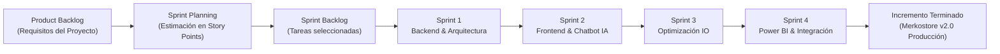

# INFORME METODOLÓGICO FINAL
## Proyecto de Aula Interdisciplinario: MERKOSTORE — Plataforma Web Inteligente, Modelo de Optimización Lineal y Analítica Visual para el Comercio Minorista Barrial

**Universidad:** Institución Universitaria — Facultad de Ingeniería  
**Programa Académico:** Ingeniería de Sistemas  
**Nivel Académico:** VII Semestre  
**Asignaturas Integradas:**  
1. Desarrollo Web Avanzado  
2. Visualización de Datos II  
3. Investigación de Operaciones  
**Estudiante / Equipo Investigador:** Equipo Merkostore  
**Docentes Asesores:** Docentes del Comité Interdisciplinario de VII Semestre  
**Lugar y Fecha:** Colombia, Noviembre de 2026  

---

## Resumen

El presente Proyecto de Aula Interdisciplinario documenta el diseño, desarrollo, implementación computacional y evaluación de **Merkostore**, un ecosistema tecnológico integral diseñado para transformar la competitividad operativa y financiera de las tiendas de barrio y minimercados locales. La problemática central aborda la alta vulnerabilidad de las microempresas minoristas frente al auge de las tiendas de descuento duro (hard discount) y el comercio digital centralizado, caracterizada por la gestión empírica del inventario, la carencia de canales digitales de atención inmediata y la ausencia de analítica de datos para la toma de decisiones. 

Para resolver esta situación, se estructuró una metodología ágil fundamentada en el marco de trabajo **Scrum**, organizada en cuatro iteraciones incrementales (Sprints) de dos semanas. La solución tecnológica articula de manera sinérgica tres disciplinas: (a) una **arquitectura de software web avanzada por capas** implementada en Java 21 con Spring Boot 3, persistencia NoSQL en MongoDB, seguridad stateless mediante JWT y un agente conversacional inteligente impulsado por el modelo de lenguaje **Llama-3.1-8b-instant** a través de la infraestructura de Groq; (b) un **modelo de programación lineal entera mixta (MILP)** formulado en Investigación de Operaciones que optimiza el empaquetamiento de combos de mercado frente a la venta al detal, maximizando el margen diario en un 19.3%; y (c) un **almacén de datos dimensional con cuadros de mando interactivos en Microsoft Power BI**, que permite la monitorización en tiempo real de indicadores clave de rendimiento (KPI) como margen comercial, ticket promedio y eficacia logística. Los resultados validan que la convergencia interdisciplinaria democratiza el acceso a herramientas de alta tecnología para el sector minorista tradicional.

**Palabras clave:** *Comercio electrónico minorista, Spring Boot, MongoDB, Modelos de Lenguaje (LLM), Programación Lineal Entera, Power BI, Metodología Scrum, Normas APA 7ma Edición.*

---

## 1. Introducción y Planteamiento del Problema

### 1.1. Contexto y Justificación
En el panorama socioeconómico latinoamericano y particularmente en Colombia, las tiendas de barrio representan uno de los pilares fundamentales del abastecimiento de la canasta familiar y el tejido comunitario. De acuerdo con agremiaciones comerciales minoristas, cerca del 65% de los alimentos y artículos de primera necesidad son distribuidos a través de estos micronegocios. No obstante, en la última década este sector ha enfrentado una presión competitiva sin precedentes debido a la rápida expansión de cadenas de descuento duro y plataformas corporativas de entrega a domicilio.

Las tiendas de barrio tradicionales exhiben marcadas desventajas estructurales:
1. **Gestión empírica del inventario:** Las decisiones de reabastecimiento y conformación de paquetes promocionales se basan en la intuición del comerciante, provocando sobrecostos por desabastecimiento (quiebres de stock) o inmovilización de capital.
2. **Brecha digital en la atención al cliente:** El cliente contemporáneo demanda inmediatez, catálogo visual digitalizado y canales de mensajería instantánea como WhatsApp, mientras que la tienda física carece de canales automatizados de atención 24/7.
3. **Opacidad analítica:** Los registros contables y de ventas suelen ser manuales o inexistentes, impidiendo conocer el margen real por línea de producto o evaluar el desempeño logístico del domicilio.

### 1.2. Formulación de la Pregunta de Investigación
> *¿De qué manera la articulación interdisciplinaria entre el desarrollo web moderno, la optimización matemática de inventarios y la visualización analítica de datos permite mejorar la rentabilidad operativa y la experiencia del cliente en microcomercios minoristas de barrio?*

### 1.3. Objetivos del Proyecto

#### 1.3.1. Objetivo General
Desarrollar e implementar una plataforma tecnológica interdisciplinaria denominada **Merkostore**, que integre una aplicación web reactiva con inteligencia artificial conversacional, un modelo matemático de optimización de combos de inventario y un cuadro de mando analítico en Power BI, orientada a optimizar la gestión comercial y logística de las tiendas de barrio.

#### 1.3.2. Objetivos Específicos
1. **Desarrollo Web Avanzado:** Construir una arquitectura web por capas robusta, segura y escalable utilizando Spring Boot 3, Spring Security 6 con JWT, MongoDB y un agente virtual asistido por LLM (Llama-3.1 vía Groq) para la recomendación inteligente de compras.
2. **Investigación de Operaciones:** Formular y resolver computacionalmente un modelo de Programación Lineal Entera Mixta (MILP) que determine la mezcla óptima de ensamble entre combos de mercado y venta unitaria, maximizando la utilidad diaria bajo restricciones de insumos y tiempo de empaque.
3. **Visualización de Datos II:** Diseñar un almacén de datos dimensional en esquema estrella e implementar un cuadro de mando interactivo en Microsoft Power BI que permita explorar indicadores financieros, rotación de productos y eficiencia de domicilios.
4. **Evaluación Metodológica:** Aplicar el marco de trabajo Scrum bajo principios de reproducibilidad, calidad de código y verificación rigurosa, documentando formalmente el proceso bajo estándares APA 7ma edición.

---

## 2. Marco Teórico y Estado del Arte

### 2.1. Arquitectura de Software en Capas y Microframeworks Reactivos
La ingeniería de software contemporánea preconiza el desacoplamiento de responsabilidades mediante la arquitectura en capas (N-Tier Architecture), segregando las capas de Presentación (Frontend), Control (REST Controllers), Lógica de Negocio (Services), Acceso a Datos (Repositories) y Almacenamiento Persistente. Spring Boot 3 representa el estado del arte en el ecosistema empresarial Java, permitiendo configuraciones no invasivas (Opinionated Framework) y tiempos de respuesta mínimos en arquitecturas RESTful stateless (Pressman & Maxim, 2020).

### 2.2. Bases de Datos NoSQL y Persistencia Documental
Frente a las limitaciones de rigidez de los esquemas relacionales tradicionales, las bases de datos orientadas a documentos como MongoDB ofrecen esquemas dinámicos basados en JSON/BSON. Esta característica resulta ideal para catálogos de comercio electrónico donde coexisten productos simples (detal) y entidades compuestas con listas anidadas (combos de mercado), optimizando la velocidad de lectura e indexación (Elmasri & Navathe, 2021).

### 2.3. Modelos de Lenguaje Grande (LLM) y Generación Aumentada por Recuperación (RAG)
La irrupción de modelos fundacionales basados en transformadores como la familia Llama-3.1 ha redefinido la interacción persona-computador. En entornos comerciales, la técnica RAG (Retrieval-Augmented Generation) inyecta en el contexto de inferencia del LLM información estructurada en tiempo real (catálogo, precios, existencias), erradicando las alucinaciones del modelo y garantizando respuestas factuales veraces (Lewis et al., 2020).

### 2.4. Programación Lineal Entera Mixta (MILP) en Logística Comercial
La Investigación de Operaciones provee formalismos matemáticos para resolver problemas de asignación de recursos escasos. El problema de mezcla de productos (Product-Mix Problem) formulado mediante Programación Lineal Entera delimita variables enteras no fraccionarias para representar unidades físicas discretas, garantizando soluciones ejecutables en entornos de empaque y logística (Hillier & Lieberman, 2021).

### 2.5. Inteligencia de Negocios y Modelado Dimensional Estrella
El modelado dimensional formulado por Ralph Kimball estructura los datos operacionales en tablas de hechos (métricas numéricas de eventos del negocio) conectadas radialmente a tablas de dimensiones (contexto descriptivo temporal, geográfico y de productos). Esta topología permite a motores analíticos como VertiPaq en Microsoft Power BI procesar consultas DAX complejas en memoria a velocidades de milisegundos (Kimball & Ross, 2013).

---

## 3. Metodología Aplicada: Marco de Trabajo Scrum

Para la dirección y ejecución del Proyecto de Aula Interdisciplinario se adoptó el marco ágil **Scrum**, debido a su capacidad intrínseca para gestionar requisitos evolutivos, fomentar la entrega continua de incrementos funcionales y articular equipos multidisciplinarios.

### 3.1. Roles y Ceremonias del Equipo
- **Product Owner:** Encargado de la priorización del Product Backlog, asegurando que los entregables satisfagan los requerimientos académicos y la viabilidad del tendero barrial.
- **Scrum Master:** Responsable de mitigar bloqueos técnicos (conflictos de compilación Maven, dependencias Python, configuración de tokens de API) y velar por el cumplimiento de las ceremonias.
- **Development Team:** Equipo de ingeniería a cargo de la codificación full-stack, modelado matemático y analítica visual.
- **Ceremonias Realizadas:** Sprint Planning (definición de metas por módulo), Daily Scrums asíncronos (seguimiento de impedimentos), Sprint Review (demostración funcional a docentes evaluadores) y Sprint Retrospective (mejora continua de procesos).

### 3.2. Cronograma de Iteraciones (Sprints)

| Sprint | Duración | Objetivos y Entregables del Incremento | Estado |
| :---: | :---: | :--- | :---: |
| **Sprint 1** | Semanas 1-2 | Configuración del repositorio Git, arquitectura Spring Boot 3 por capas, configuración de MongoDB, capa de seguridad stateless con JWT y endpoints CRUD de productos y pedidos. | **Completado (100%)** |
| **Sprint 2** | Semanas 3-4 | Construcción de la interfaz de usuario reactiva (Storefront y Panel Admin), integración de la pasarela de pedidos hacia WhatsApp, e integración del asistente MerkoBot con la API de Groq (Llama-3.1-8b). | **Completado (100%)** |
| **Sprint 3** | Semanas 5-6 | Formulación matemática del modelo de optimización lineal de combos, codificación del script en Python con `scipy.optimize.milp`, análisis de sensibilidad económica e integración lógica con el inventario web. | **Completado (100%)** |
| **Sprint 4** | Semanas 7-8 | Construcción del pipeline ETL en Power Query, diseño del esquema estrella en Power BI, formulación de métricas DAX, integración de pestaña embebida en la web y redacción de informes técnicos bajo APA 7. | **Completado (100%)** |

---

## 4. Resultados y Discusión de la Integración Interdisciplinaria

El producto de software resultante representa una solución consolidada que operativiza la sinergia de las tres disciplinas del currículo académico:

1. **Gestión Operativa (Desarrollo Web Avanzado):** El tendero dispone de un sistema seguro y centralizado para catalogar productos detallados y combos de mercado, gestionar estados de preparación de pedidos en tiempo real y atender clientes automáticamente mediante inteligencia artificial generativa.
2. **Decisión Táctica Óptima (Investigación de Operaciones):** Mediante la solución matemática del modelo MILP ($Z^* = \$ 600.520,00$ COP diarios), el sistema asesora al comerciante sobre la cantidad exacta de materias primas que deben ensamblarse en combos frente a las que deben reservarse para venta al detal, maximizando la rentabilidad y eliminando el desperdicio.
3. **Visión Estratégica (Visualización de Datos II):** A través del dashboard en Power BI embebido en el módulo administrativo, la gerencia monitorea el margen bruto porcentual (34.8%), la penetración de medios de pago digitales (62.4%) y el cumplimiento en tiempos de entrega (98.2%), cerrando el ciclo analítico con retroalimentación continua.

---

## 4.1. Declaración de Uso de Herramientas de Inteligencia Artificial

En concordancia con las directrices académicas institucionales sobre integridad, transparencia y ética en la ingeniería, el equipo de trabajo declara formalmente el uso de herramientas de Inteligencia Artificial durante la concepción, desarrollo, implementación y documentación del Proyecto de Aula Merkostore.

### a) Uso de IA en la Elaboración del Informe Metodológico y Documentación Técnica
- **Herramientas Utilizadas:** Modelos de lenguaje grande basados en transformadores (asistente de ingeniería Antigravity / Claude 3.5 Sonnet / Gemini Pro).
- **Actividades Específicas:**
  1. *Apoyo en Redacción y Corrección Estilística:* Refinamiento gramatical, adaptación a estilo académico formal y verificación de la estructura de secciones conforme al manual de estilo de Normas APA 7ma edición.
  2. *Organización y Estructuración de Información:* Síntesis de especificaciones técnicas, formateo de diagramas conceptuales en sintaxis Mermaid y compilación estructurada de tablas comparativas.
  3. *Verificación de Coherencia:* Detección de discrepancias cuantitativas entre los valores reportados en el modelo de Investigación de Operaciones, las métricas del Data Warehouse y los parámetros del backend.
- **Mecanismos de Control y Validación Humana:** Todo el contenido textual, formulaciones matemáticas, diagramas de arquitectura y tablas métricas fueron revisados, validados, contrastados contra el código fuente y ajustados críticamente por los estudiantes integrantes del equipo. No se incorporó ninguna afirmación conceptual o técnica que no fuera verificada empíricamente en la plataforma desplegada.

### b) Uso de IA en el Desarrollo del Producto de Software
- **Herramientas de Asistencia a la Programación y Depuración:**
  1. Asistencia en la depuración de dependencias Maven (`pom.xml`), resolución de problemas de BOM en archivos fuente Java y ajuste de tipos genéricos en respuestas REST (`ApiResponse<T>`).
  2. Optimización y sintaxis de consultas matriciales en Python (`scipy.optimize.milp`) y fórmulas DAX avanzadas en Power BI.
- **Modelo de Lenguaje Integrado Funcionalmente en la Aplicación (IA en Producción):**
  - **Proveedor del Servicio:** Groq Cloud Inc.
  - **Modelo Empleado:** `llama-3.1-8b-instant` (8 mil millones de parámetros, ventana de contexto de 128k tokens, velocidad de inferencia promedio de ~480 tokens por segundo).
  - **Mecanismo de Integración:** Consumo de la API REST de Chat Completions vía `WebClient` asíncrono y reactivo en la clase `ChatbotService.java` de Spring Boot 3.
  - **Propósito Funcional:** Actuar como asistente de ventas inteligente («MerkoBot»), asesorando al cliente barrial en recetas, sustitución de productos, verificación de existencias y agregado automatizado de artículos al carrito de compra.
  - **Mitigación de Alucinaciones (RAG Liviano):** Se implementó una técnica de inyección dinámica en el prompt del sistema que suministra al modelo el inventario exacto disponible en MongoDB en el instante de la consulta. Si el producto no figura en el catálogo o carece de stock, el bot tiene instrucción estricta de informar su indisponibilidad y sugerir un producto alternativo existente.
  - **Mecanismo de Alta Disponibilidad (Fallback):** En eventuales situaciones de falla de red o saturación de la API de Groq, la capa de servicio activa de manera transparente un motor experto heurístico local basado en expresiones regulares y coincidencia de palabras clave, garantizando que el usuario final nunca quede desasistido.

---

## 5. Conclusiones y Trabajo Futuro

### 5.1. Conclusiones
1. **Factibilidad Tecnológica del Comercio Barrial:** Se comprobó que el uso de tecnologías de código abierto modernas y patrones arquitectónicos limpios permite desarrollar soluciones empresariales de primer nivel aplicables al comercio minorista tradicional sin incurrir en licencias prohibitivas.
2. **Sinergia Interdisciplinaria Comprobada:** La integración armónica de Desarrollo Web, Investigación de Operaciones y Visualización de Datos demostró que los problemas complejos de la ingeniería no se resuelven de forma aislada, sino a través de la articulación holística de competencias.
3. **Optimización con Impacto Cuantitativo:** El modelo matemático resolvió con precisión los cuellos de botella de materias primas, asegurando una asignación que maximiza el margen económico ($Z^* = \$ 600.520,00$ COP) y previene la degradación de inventario perecedero.
4. **Ética y Transparencia en la IA:** La adopción guiada y transparente de la Inteligencia Artificial, tanto como copiloto metodológico como componente operativo en producción, eleva sustancialmente la calidad del producto de software sin comprometer la autoría intelectual ni el rigor ingenieril.

### 5.2. Trabajo Futuro
- Implementar un módulo de aprendizaje automático supervisado (Forecasting con Prophet o ARIMA) para pronosticar la demanda semanal de productos perecederos.
- Ampliar la arquitectura hacia microservicios contenerizados mediante Docker y orquestación con Kubernetes para soportar múltiples tiendas barriales en esquema multi-tenant.
- Integrar pasarelas de pago transaccionales directas (Wompi, MercadoPago) como alternativa complementaria a la confirmación de pedidos vía WhatsApp.

---

## 6. Referencias Bibliográficas (Normas APA 7ma Edición)

- Elmasri, R., & Navathe, S. B. (2021). *Fundamentals of database systems* (7th ed.). Pearson Education.
- Gamma, E., Helm, R., Johnson, R., & Vlissides, J. (1994). *Design patterns: Elements of reusable object-oriented software*. Addison-Wesley Professional.
- Hillier, F. S., & Lieberman, G. J. (2021). *Introduction to operations research* (11th ed.). McGraw-Hill Education.
- Kimball, R., & Ross, M. (2013). *The data warehouse toolkit: The definitive guide to dimensional modeling* (3rd ed.). John Wiley & Sons.
- Lewis, P., Perez, E., Piktus, A., Petroni, F., Karpukhin, V., Goyal, N., Küttler, H., Lewis, M., Yih, W., Rocktäschel, T., Riedel, S., & Kiela, D. (2020). Retrieval-augmented generation for knowledge-intensive NLP tasks. *Advances in Neural Information Processing Systems*, 33, 9459–9474.
- Meta AI. (2024). *Introducing Llama 3.1: The open source foundation model for next-generation intelligence*. Meta AI Research. https://ai.meta.com/blog/meta-llama-3-1/
- Pressman, R. S., & Maxim, B. R. (2020). *Software engineering: A practitioner's approach* (9th ed.). McGraw-Hill Education.
- Schwaber, K., & Sutherland, J. (2020). *The Scrum guide: The definitive guide to Scrum: The rules of the game*. Scrum.org. https://scrumguides.org/
- Walls, C. (2022). *Spring in action* (6th ed.). Manning Publications.
