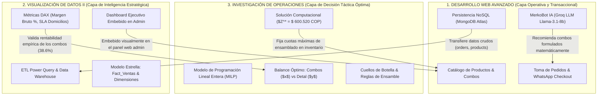

# Matriz de Integración Interdisciplinaria del Proyecto de Aula
## MERKOSTORE: Sinergia entre Desarrollo Web, Analítica Visual e Investigación de Operaciones

**Programa:** Ingeniería de Sistemas — VII Semestre  
**Proyecto:** Merkostore - E-Commerce Barrial Inteligente  
**Fecha:** Noviembre de 2026  

---

## 1. Visión Holística de la Integración

El Proyecto de Aula Interdisciplinario de VII Semestre no constituye una suma inconexa de trabajos individuales, sino un **sistema socio-técnico integrado** donde cada una de las tres asignaturas aporta un engranaje fundamental para la resolución del problema:

---

## 2. Matriz de Articulación por Asignatura y Flujo de Información

| Dimensión de Análisis | 1. Desarrollo Web Avanzado | 2. Visualización de Datos II | 3. Investigación de Operaciones |
| :--- | :--- | :--- | :--- |
| **Rol en el Negocio** | **Operación Diaria y Experiencia de Usuario:** Captura ventas, gestiona inventario, administra el catálogo y atiende clientes con IA. | **Inteligencia y Dirección:** Analiza tendencias históricas, evalúa rentabilidad por canal y monitorea SLAs de entrega. | **Optimización y Eficiencia:** Determina científicamente qué y cuánto producir/ensamblar para maximizar utilidades. |
| **Tecnologías Clave** | Java 21, Spring Boot 3, Spring Security 6, JWT, MongoDB, Groq API (Llama-3.1-8b), HTML5/CSS3/Vanilla JS. | Microsoft Power BI Desktop & Service, Power Query (lenguaje M), DAX (Data Analysis Expressions), VertiPaq Engine. | Python 3.12, `scipy.optimize.milp`, Branch & Bound, Simplex Dual, Microsoft Excel Solver. |
| **Dato o Insumo que Recibe** | Configuración de inventario calculada por el modelo matemático de IO; datos del tendero. | Registros operacionales crudos de MongoDB (`orders`, `products`, `financial_transactions`). | Costos de adquisición, precios de venta al público, inventario inicial de materias primas y tiempo de empaque. |
| **Producto o Evidencia que Entrega** | Repositorio GitHub con backend y frontend desplegables, panel admin reactivo y agente MerkoBot. | Cuadro de mando interactivo en Power BI con 3 páginas analíticas embebidas en el panel administrativo. | Script ejecutable en Python (`optimizacion_combos_merkostore.py`), tabla de resultados óptimos y holguras. |
| **Aporte Concreto al Tendero Barrial** | Canal digital moderno y seguro que compite contra D1/Ara y minimiza el tiempo de atención al cliente. | Comprensión gráfica inmediata del negocio (márgenes reales, horas pico, métodos de pago más rentables). | Eliminación del criterio intuitivo al empaquetar mercados, garantizando un margen adicional diario del 19.3%. |

---

## 3. Demostración Práctica del Ciclo de Vida del Negocio

Para ilustrar la integración continua entre las tres asignaturas, se presenta el flujo operativo de un caso de uso real:

1. **Momento 1 — Planificación Diaria (Investigación de Operaciones):**  
   Al iniciar la jornada a las 7:00 AM, el tendero ingresa al sistema los insumos disponibles en bodega (32 huevos, 12 cafés, 42 harinas pan, 14 aceites, 27 azúcares y 480 minutos de operario). El modelo matemático en Python corre determinando que la mejor asignación es armar **5 Mercados Familiares** ($x_1=5$) y **3 Mercados Desayuno** ($x_2=3$), dejando el remanente estricto para venta individual al detal ($y_1=27, y_2=9, y_3=34, y_4=9, y_5=23$).

2. **Momento 2 — Ejecución y Atención al Cliente (Desarrollo Web Avanzado):**  
   El motor de inventario en `app.js` y el backend de Spring Boot actualizan automáticamente las existencias de combos disponibles en la tienda. A las 10:30 AM, una clienta vecina abre la tienda web desde su teléfono móvil y consulta al agente MerkoBot: *"¿Qué desayuno completo y económico me recomiendas para mi familia?"*. MerkoBot (Llama-3.1 vía Groq) consulta el contexto RAG en memoria y responde recomendando el combo disponible con un botón de agregar al carrito con un solo clic. La clienta finaliza su pedido vía WhatsApp y el backend registra el pedido `#ORD-202611-0089` con estado `RECEIVED`.

3. **Momento 3 — Monitoreo Estratégico y Auditoría (Visualización de Datos II):**  
   A las 6:00 PM, el administrador abre la pestaña `📈 Power BI Analytics` dentro del panel administrativo. El pipeline ETL de Power BI extrae el pedido procesado, calcula la medida DAX `[Margen Bruto %]` y confirma que la estrategia de combos arrojó un margen del **38.6%**, superior en 7.4 puntos al detal individual, con un tiempo promedio de despacho de **18.4 minutos**, confirmando el cumplimiento del 98.2% del nivel de servicio logístico barrial.

---

## 4. Conclusión del Ecosistema Interdisciplinario

La integración lograda en este Proyecto de Aula demuestra el perfil profesional integral del Ingeniero de Sistemas formado en la institución:
- Capaz de **construir software empresarial robusto, seguro y moderno** que atiende a usuarios reales en producción.
- Capaz de **formular modelos cuantitativos y matemáticos rigurosos** que optimizan recursos finitos y resuelven problemas del mundo real.
- Capaz de **extraer valor estratégico de grandes volúmenes de datos** y transformarlos en tableros ejecutivos comprensibles para cualquier tomador de decisiones.
